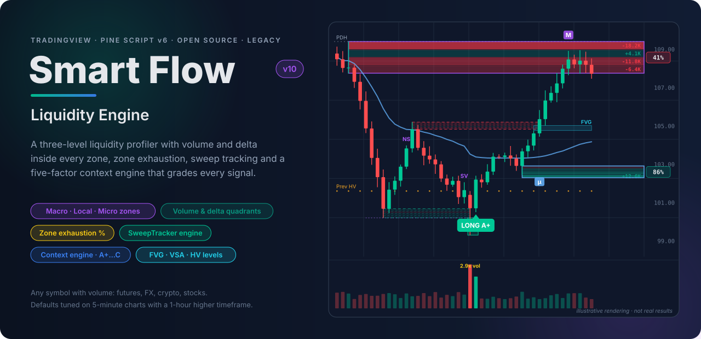
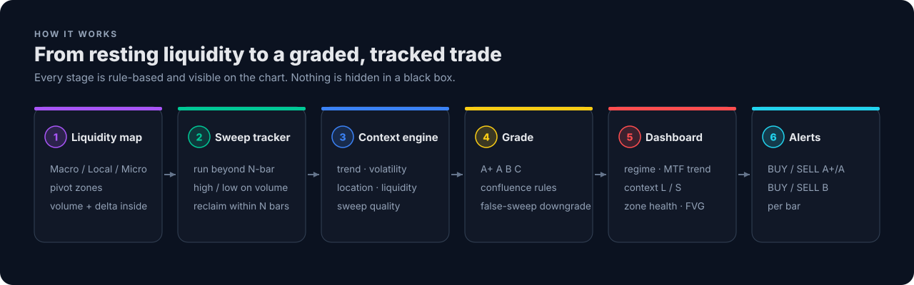
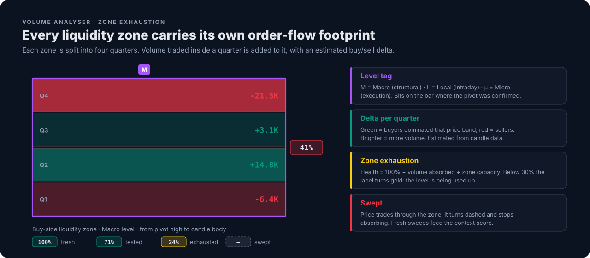
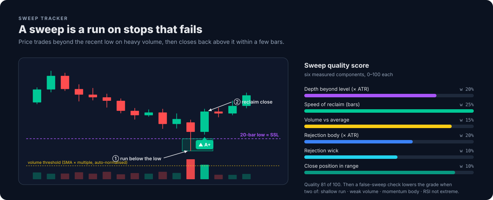
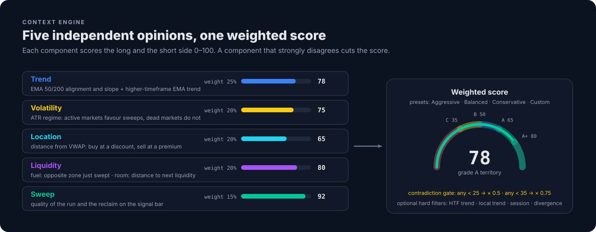
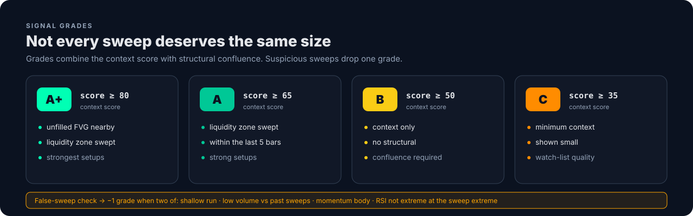
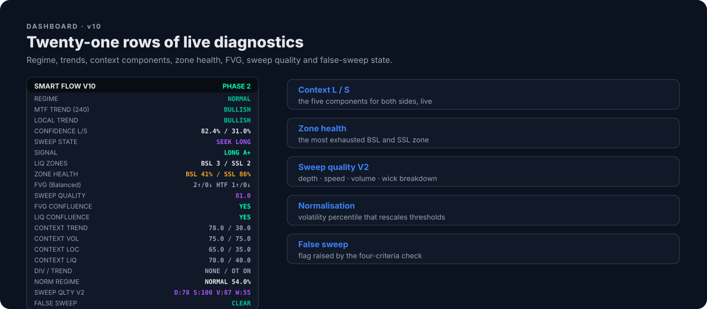
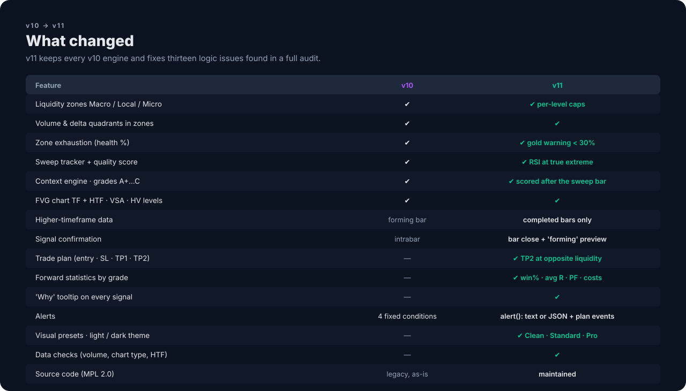

  

  
  
  
  
  

  <b>A liquidity engine for TradingView: where stops rest, how much volume each level has already absorbed, and when a sweep of those stops is worth attention.</b>

> **Status: legacy.** The v10 source is published as-is for reference and study: [`src/smart_flow_v10.pine`](src/smart_flow_v10.pine).
> The trading logic is unchanged from the original build. A full audit found 13 logic issues (see [Known issues](#-known-issues)).
> For trading, use the maintained successor: **[Smart Flow v11 — Liquidity Sweeps & Trade Plan](https://github.com/sergeyrokossovsky-rgb/smart-flow)**.

---

## ⚙ Architecture

Five engines run on every bar:

| Engine | Role |
|---|---|
| **Liquidity Profiler** | Builds buy-side and sell-side zones from pivots on three levels and records the volume and delta traded inside each one |
| **SweepTracker** | Detects a run beyond the recent high or low on elevated volume, waits for the reclaim and scores its quality |
| **Context Engine** | Scores trend, volatility, location, liquidity and sweep quality for both sides and combines them under a contradiction gate |
| **Signal Grading** | Converts the score and structural confluence into A+ / A / B / C, then applies the false-sweep downgrade |
| **Multi-Asset Normalisation** | Rescales sweep-volume, FVG-size and activity thresholds by the symbol's volatility percentile |

---

## ◧ Liquidity Profiler: volume analyser & zone exhaustion

- **Three-level hierarchy.** Macro zones are structural, Local zones are intraday and Micro zones are for execution. Each level has its own pivot lookback and its own confirmation delay.
- **Delta quadrants.** Each zone is split into four price bands. Every bar that trades into a band adds its overlapping volume, signed by candle direction. The result is a heat map of who defended the level and where.
- **Zone health.** Each zone has a capacity (a multiple of average volume). As volume is absorbed, health falls from 100%. A low-health zone is an exhausted level.
- **Swept zones** turn dashed and stay on the chart as context.
- **Overlap filter.** Overlapping zones on the same level are merged. Different levels may nest inside each other.

---

## ⤓ SweepTracker

A sweep starts when the previous bar breaks the N-bar extreme with volume above a normalised multiple of its average. It becomes a signal when price closes back inside within the timeout. Its quality score is built from six components: depth, speed, volume, rejection body, wick and close position.

**False-sweep detection** checks four signs: shallow penetration, low volume compared with previous sweeps, a momentum body and RSI outside the extreme zone. Two or more lower the grade by one level.

---

## ◎ Context Engine & grades

The trend component includes the higher-timeframe EMA trend. Signals can also be filtered by local trend, session and RSI divergence.

---

## ▤ Dashboard

---

## ✚ Also on the chart

| Layer | Description |
|---|---|
| **Fair value gaps** | Chart timeframe and higher timeframe. Size, displacement and impulse filters. Relaxed / Balanced / Strict presets. Optional removal on fill |
| **VSA** | Stopping-volume (SV) and no-supply (NS) bars |
| **Prev-session HV levels** | High and low of the highest-volume bar of the previous session |
| **VWAP** | Session VWAP used by the location context |
| **Sweep levels & sweep zone** | Rolling break levels and the active sweep window |
| **Alerts** | BUY / SELL A+/A and B |

---

## ⚠ Known issues

These are documented so that v10 behaves the way you expect. All of them are fixed in v11.

| # | Issue | Practical effect |
|---|---|---|
| E1 | Context scored before the sweep of the current bar | Sweep quality does not affect the grade |
| E2 | Divergence compares a pivot with the bar 12 candles back | Divergence almost never fires |
| E3 | `last_visible_bar = bar_index - max_history` | "Max Bars Back" limits nothing |
| E4 | Alert text uses `{{plot_0}}` / `{{plot_1}}` | Alerts show the previous-session HV level instead of confidence |
| E5 | Signal labels have no budget | Old zone labels can disappear on long histories |
| E6 | One zone cap shared by all levels | Micro zones can push Macro zones out |
| E7 | RSI check on the reclaim bar | The false-sweep filter fires too often |
| E8 | Two session switches | "Use Session Filter" alone does not filter |
| E9 | VSA colour inputs not applied | Colour settings have no effect |
| E10 | Liquidity context lags one bar | The liquidity component reflects the previous bar |
| E11 | HTF fixed at 4H, `lookahead_off` on a forming bar | The trend filter repaints in real time; meaningless on charts at 4H or above |
| E12 | Dashboard confluence rows read only on the signal bar | Usually shows "--" |
| E13 | With the hard divergence filter, a bearish divergence caps short confidence | Both directions can be blocked |

Also: signals are evaluated on the open bar, so they may appear and disappear before the bar closes.

## ▶ Using the source

1. TradingView → **Pine Editor** → *New blank indicator*. Paste [`src/smart_flow_v10.pine`](src/smart_flow_v10.pine).
2. Click **Save**, then **Add to chart**.

---

## v10 → v11

v11 keeps every v10 engine, fixes the issues above and adds trade plans, forward statistics, visual presets and JSON alerts.

**→ [Get Smart Flow v11 (open source)](https://github.com/sergeyrokossovsky-rgb/smart-flow)**

---

Smart Flow is an analytical tool, not financial advice. Trading involves substantial risk of loss. Chart images are illustrative renderings, not real results. Source code: Mozilla Public License 2.0, provided as-is.
